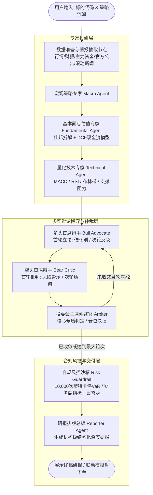

# 基于 LLM 的金融分析多 Agent 投研协同系统
### (Financial Multi-Agent Investment Research & Trading Platform)

> 一个高保真、工业级架构的金融多智能体（Multi-Agent）投研协同决策平台。结合 **LangGraph 状态图工作流编排**、**多源真实行情与情报抓取**、**确定性量化估值/风控沙箱**、**多空博弈对抗辩论机制** 与 **投研模拟盘交易闭环**。

---

## 🌟 核心亮点与系统特性

1. **多源异构真实金融数据与情报感知**：
   - **资金面**：直连东方财富分时主力资金流接口，实时提取主力大单与超大单净买卖动向。
   - **信息面**：直连东方财富/巨潮官方上市公司正式披露公告库，提取近期重大公告（减持、质押、定增、业绩快报等）。
   - **舆情面**：对接新浪财经个股滚动要闻流，捕获盘口即时动态。
   - **行情与财报**：实时拉取日K线历史与财务三表，支持离线沙箱弹性降级。

2. **专业多智能体分工协同 (LangGraph StateGraph)**：
   - 🏛️ **宏观策略专家 (Macro Agent)**：研判宏观流动性、货币与产业政策、地缘政治与周期位置。
   - 📊 **基本面专家 (Fundamental Agent)**：运行**杜邦分析法 (DuPont Analysis)** 穿透 ROE 质量，结合 **三阶段 DCF 自由现金流折现模型** 测算内在公允价值与安全边际。
   - 📈 **技术形态专家 (Technical Agent)**：纯 Python/NumPy 确定性量化引擎，测算 14日 RSI、MACD、布林带轨道及支撑/阻力位。

3. **双轮动态多空对抗辩论与收敛仲裁 (Debate & Consensus Engine)**：
   - 🐂 **多头首席辩手 (Bull Advocate)**：挖掘预期差、催化剂（Catalysts）与估值修复上行空间；次轮对空方质疑进行针对性反驳与证据防御。
   - 🐻 **空头首席辩手 (Bear Critic)**：紧盯财务杠杆风险、预期透支与估值泡沫，指出致命漏洞（Vulnerabilities）；次轮进行穿透式精准质询。
   - ⚖️ **投委会主席 (Arbiter Node)**：调和多空分歧，提炼核心矛盾与赔率不对称比（Risk/Reward），出具终局投资评级、建议仓位与梯次建仓节奏。
   - 🛡️ **防无限死循环熔断器**：状态图内置收敛容差判定与最大辩论轮次硬熔断控制。

4. **确定性合规风控硬拦截沙箱 (Risk Guardrail)**：
   - **10,000 次蒙特卡洛 VaR 模拟**：基于历史几何布朗运动随机走势，测算 95% 置信度下单周最大潜在在险损失。
   - **一票否决权**：对资产负债率、利息保障倍数、极限下行回撤等硬红线实行确定性规则穿透拦截，防范大模型“幻觉”导致合规失误。

5. **模拟盘交易撮合引擎 (Paper Trading System)**：
   - 提供 100 万元初始虚拟资金账户管理，本地 JSON 持久化存储。
   - 支持市价委托撮合、真实交易印花税/佣金费率核算、持仓浮动盈亏与已实现盈亏统计。
   - **投研一键建仓联动**：支持将投委会决议建议仓位自动换算为 100 股（1手）整倍数并一键直达模拟盘下单。

6. **沉浸式现代 Web 交互看板**：
   - 原生 HTML5/CSS3/JavaScript 编写，无需复杂前端打包环境。
   - 支持多策略风格一键切换（动量主升、机构均衡、深度价值、短线游资）及 4 维指标权重自定义微调。
   - 集成大模型网关可视化配置弹窗（可在线切换 DeepSeek / Qwen 等 OpenAI 协议模型并进行实时联通测试）。
   - 全流程 Server-Sent Events (SSE) 实时打字机流式事件推送。

---

## 🏗️ 系统架构图



---

## 📂 项目工程目录结构

```text
01-基于LLM的金融分析AI_Agent/
├── app/
│   ├── agents/                     # 智能体专长模块
│   │   ├── base_agent.py           # Agent 抽象基类与安全 JSON 解析
│   │   ├── macro_agent.py          # 宏观与产业政策专家
│   │   ├── fundamental_agent.py    # 基本面财务与估值专家
│   │   ├── technical_agent.py      # 技术形态与指标专家
│   │   ├── debate_engine.py        # 多空辩论对决与仲裁引擎 (Bull / Bear / Arbiter)
│   │   ├── risk_guardrail.py       # 合规风控硬拦截沙箱
│   │   └── reporter_agent.py       # 机构研报排版生成 Agent
│   ├── api/                        # FastAPI 路由层
│   │   ├── financial_router.py     # 投研分析与 SSE 流式接口、模型配置接口
│   │   └── portfolio_router.py     # 模拟盘账户资产、委托撮合接口
│   ├── core/                       # 核心底层与通用配置
│   │   ├── config.py               # 全局超参数与环境配置加载器
│   │   └── llm_provider.py         # OpenAI 协议兼容的大模型统一调度器
│   ├── graph/                      # 状态图编排层
│   │   └── financial_graph.py      # LangGraph 投委会多智能体状态图拓扑定义
│   ├── models/                     # Pydantic 数据规范与协议契约
│   │   ├── agent_state.py          # 全局 LangGraph 状态机字典类型 (FinancialAgentState)
│   │   ├── schemas.py              # 研报、行情、情报、多空辩论结构模型
│   │   └── portfolio_schemas.py    # 模拟盘持仓、委托订单数据契约
│   └── tools/                      # 确定性量化分析与外部数据工具
│       ├── market_data.py          # 行情历史与财报接口 (集成东财/新浪及离线沙箱)
│       ├── market_intel.py         # 多源资金流、官方披露公告、滚动舆情抓取器
│       ├── financial_metrics.py    # 杜邦拆解与三阶段 DCF 估值引擎
│       ├── quant_indicators.py     # MACD、RSI、布林带技术形态量化引擎
│       ├── risk_calculator.py      # 10,000 次蒙特卡洛 VaR 模拟风险价值引擎
│       └── portfolio_manager.py    # 模拟账户资产持久化与撮合管理
├── data/                           # 本地持久化数据目录 (模拟盘账本等)
│   └── paper_portfolio.json        # 模拟盘账户数据
├── static/                         # 前端 Web 静态资源
│   └── index.html                  # 现代化响应式投研交互看板
├── .env.example                    # 环境变量配置模板
├── main.py                         # 系统启动入口文件
├── requirements.txt                # Python 依赖清单
└── README.md                       # 项目工程文档
```

---

## 🚀 快速上手与部署运行

### 1. 环境准备
推荐使用 **Python 3.10 ~ 3.12** 运行环境。建议在虚拟环境中运行：

```bash
# 创建虚拟环境 (Windows PowerShell)
python -m venv .venv

# 激活虚拟环境 (Windows)
.venv\Scripts\Activate.ps1

# 激活虚拟环境 (Linux/macOS)
source .venv/bin/activate
```

### 2. 安装项目依赖
```bash
pip install -r requirements.txt
```

### 3. 配置环境变量 (可选但推荐)
复制项目根目录下的 `.env.example` 为 `.env`：
```bash
cp .env.example .env
```
用文本编辑器打开 `.env` 并填入您的大模型 API 密钥（推荐使用性价比极高的 **DeepSeek**）：
```ini
LLM_API_KEY=sk-your-deepseek-api-key
LLM_BASE_URL=https://api.deepseek.com
LLM_DEFAULT_MODEL=deepseek-chat
```
> 💡 **提示**：即使未在 `.env` 中预先配置 API Key：
> 1. 您也可以在启动后的网页右上角点击 **⚙️ 大模型配置** 在线录入并测试连通性；
> 2. 若完全不配置 API Key，系统具备完善的高保真降级机制，会自动切换到离线金融模拟器运行，绝不抛出异常阻断流程！

### 4. 启动服务
```bash
python main.py
```
终端输出如下内容即表示启动成功：
```text
INFO:     Started server process
INFO:     Waiting for application startup.
INFO:     Application startup complete.
INFO:     Uvicorn running on http://0.0.0.0:8000 (Press CTRL+C to quit)
```

### 5. 访问系统
在浏览器打开：
👉 **http://localhost:8000**

即可开始体验：
- 🔍 输入任意 A 股代码（如 `600519` 贵州茅台、`300750` 宁德时代、`002594` 比亚迪）
- 🎛️ 自由选择策略流派或自定义微调指标权重
- ⚡ 实时观看多智能体执行流、资金舆情感知与多空激烈辩论
- 📝 查阅高规格投研深度研报与一键模拟盘下单

---

## 🛠️ 常见问题排查 (FAQ)

1. **Q: 启动提示 `ModuleNotFoundError: No module named 'requests'`？**  
   **A:** 请确认已执行 `pip install -r requirements.txt`，最新版已包含 `requests`。

2. **Q: 网页端提示“大模型 API 连接失败”？**  
   **A:** 
   - 检查 API Key 是否有效，是否有额度；
   - 检查 Base URL 是否正确（DeepSeek 官方是 `https://api.deepseek.com`）；
   - 如果网络环境有代理，可检查终端是否正常访问该网关域名。

3. **Q: 模拟盘的数据保存在哪里？如何重置？**  
   **A:** 模拟盘数据保存在 `data/paper_portfolio.json`。如需重置为初始 100 万元全新账户，直接删除该文件或在模拟盘页面点击重置即可，系统会在下次读写时自动重新创建。

---

## 📄 授权与免责声明
本项目仅供学术研究、技术交流与个人投研学习使用。系统生成的量化指标、AI 辩论观点及投资评级均不构成任何实质性投资建议或收益承诺。证券市场有风险，入市决策需谨慎。
